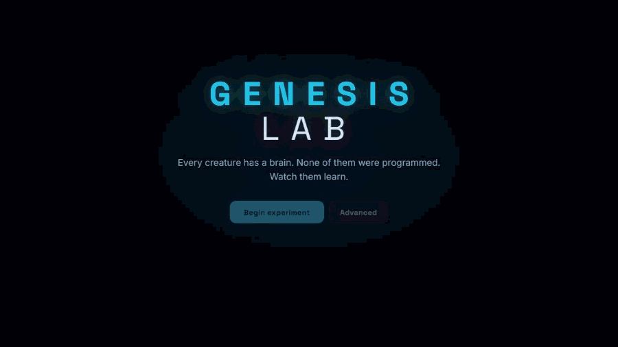
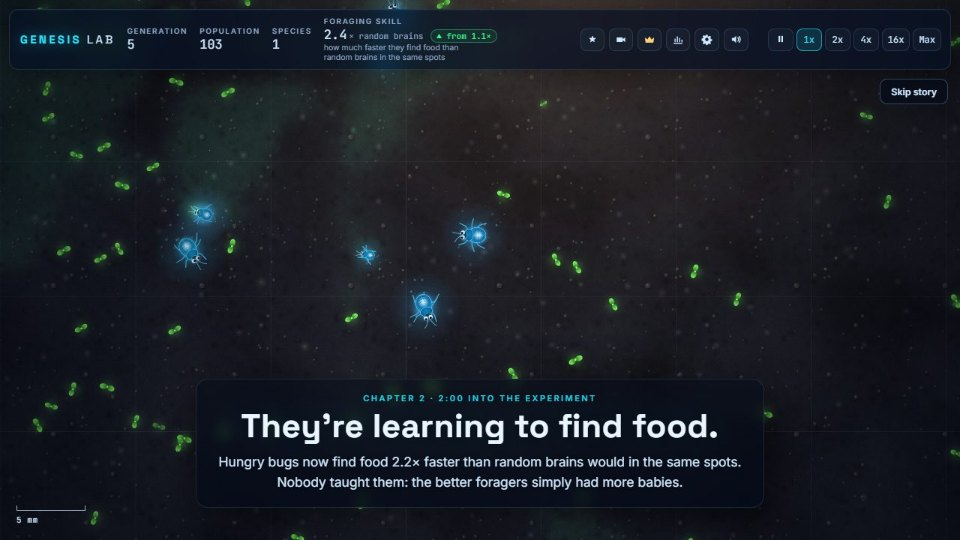
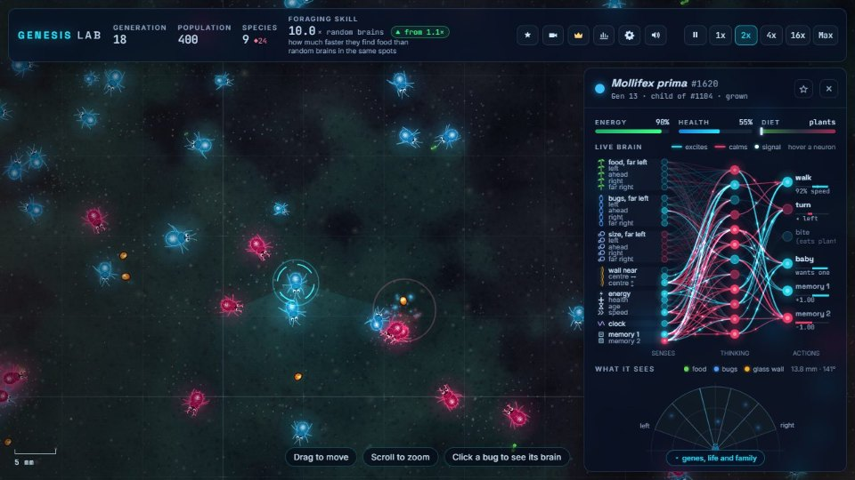
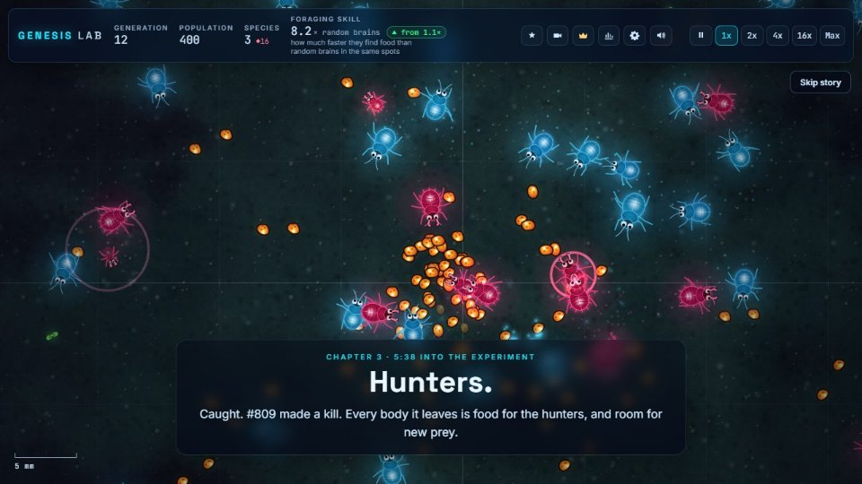
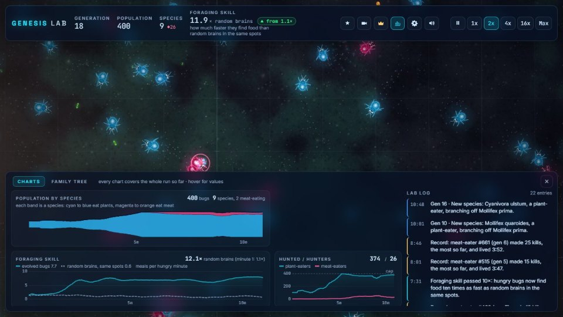
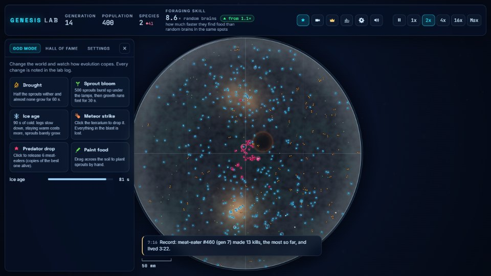
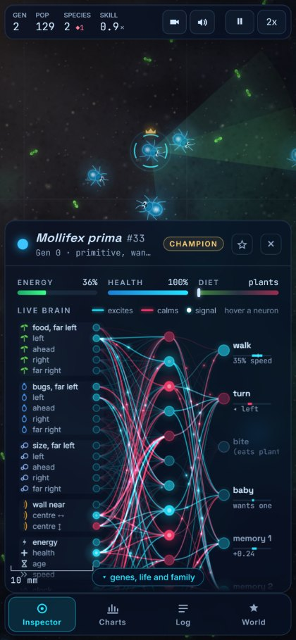

# Genesis Lab

**Every creature has a brain. None of them were programmed. Watch them learn.**

  

<h3 align="center"><a href="https://fortezzo.github.io/genesis-lab/">▶ Try it live</a></h3>

No install, no account, no servers. It runs in your browser, on a laptop or a phone.

## What you're looking at

A round glass terrarium seen from above, where glowing bugs walk, eat sprouts, have babies and die. Each bug thinks with its own small neural network, and at the start every one of those networks is random, so nobody knows how to find food. Within a few minutes, without anyone teaching them, the bugs that happen to steer toward food leave more babies, and the whole population learns to forage, splits into species, and grows its own predators.

## Features

| | |
| --- | --- |
|  | **A guided story.** First-time visitors get a 3-5 minute documentary of their own world. Every chapter is triggered by something that really happened in this run, and the camera flies to it. |
|  | **Click any bug to see its brain.** 25 senses, 12 hidden neurons and 6 actions, firing live, with a radar of what it sees. Hover a neuron to read what is exciting or calming it. |
|  | **Predators evolve on their own.** A rare gut-switch mutation makes a meat-eater, its inherited forager brain starts chasing other bugs, and in most worlds a hunter species takes hold. |
|  | **Proof, not vibes.** Foraging skill compares evolved bugs with invisible random-brain "ghost" bugs in the same spots at the same moment. Plus a species streamgraph, a family tree and a lab log that writes the story. |
|  | **God mode and the Hall of Fame.** Drought, ice age, meteor strikes and predator drops; save your favourite creatures and share them as codes. |
|  | **Works on phones.** Pinch, drag and tap, with a slim top bar and one bottom sheet at a time. Save a whole world to a file and load it back anywhere. |

## How it works

Picture a glass terrarium on a lab bench, sped up a million times. Nobody designs the behaviour; the world selects it.

1. **See.** Each bug splits its field of view into 5 slices and notices the nearest food, the nearest bug (and how big it is) and the glass wall in each.
2. **Think.** A neural network turns those senses, plus its energy, health, age, an inner clock and two memory values, into decisions.
3. **Act.** Walk, turn, bite, or try to have a baby.
4. **Survive.** Walking, seeing and thinking cost energy; eating pays it back. When energy runs out, the bug dies and leaves room for others.
5. **Reproduce.** A well-fed adult splits off a baby that copies its DNA: 9 body genes and 390 brain numbers.
6. **Mutate.** A few of those numbers change a little at random.

Most changes do nothing or hurt. Now and then a baby is slightly better at finding food, lives longer and leaves more babies. Repeat for hundreds of generations and you get bugs that beeline for food, hunt, and split into species.

## Under the hood

For engineers. Plain JavaScript and Canvas 2D, about 9,500 lines, **no libraries, frameworks, build step or AI services**. The neural networks and the evolution are written from scratch.

- **Brain:** a fixed 25 → 12 → 6 network with tanh activations, 390 weights and biases stored in the DNA as one `Float32Array`, run once per tick for every creature.
- **Senses:** 5 view slices instead of ray casting. Each bug asks a spatial grid for nearby things, bins each into its slice by angle, and keeps the nearest per slice. Food inputs are scaled 0-8, so random brains react strongly (half toward food, half away) and selection only has to pick the right half.
- **Spatial grid:** a hash grid with 160-unit cells, rebuilt every tick, so each bug checks only nearby cells. With about 350 bugs and 1,000 sprouts, a tick takes about 0.7 ms and a frame draws in under 2 ms in headless Chrome.
- **Fixed-step loop:** 60 simulation ticks per simulated second, separate from drawing, so the world behaves the same on every device and at every speed. The same seed gives the same world.
- **Energy model:** upkeep grows with body size², walking with speed² × size, eyes with sight range × field of view; fast long legs turn slowly, so no gene is a free upgrade. In-between diets digest both foods poorly (plants (1 − diet)², meat diet²), which splits predators from prey.
- **A fair learning proof:** 64 invisible ghost bugs copy real bugs' bodies and places with fresh random brains, using their own random numbers so the real world is unchanged. Foraging skill = how fast hungry real bugs find food ÷ how fast hungry ghosts do.
- **Determinism checks:** a headless test runs the simulation flat out with no drawing. The interface, sound and guided story only read the world, and saving then loading a world continues it tick for tick, both checked by comparing fingerprints of every creature.
- **Drawing:** pre-rendered glow sprites with additive blending, six-legged bugs with a tripod gait, a floor texture painted once per world, only what's on screen drawn, and automatic quality that scales effects down when the frame rate drops.

## Controls

| Input | Action |
| --- | --- |
| Drag / scroll / pinch | Move and zoom |
| Click or tap a bug | Open its brain and follow it |
| Space | Pause or resume |
| 1-5 | Speed 1x, 2x, 4x, 16x, Max |
| F | Follow the champion |
| C | Charts, family tree and lab log |
| G | God mode, Hall of Fame and Settings |
| V | Cinematic camera |
| M | Mute |
| H | Hide all panels (screenshot mode) |
| P | Save a screenshot |
| Esc | Put a tool away, stop the cinematic camera, or deselect |
| ` | Debug overlay |

## Run it yourself

1. Download this repo (green **Code** button, then **Download ZIP**) and unzip it.
2. Double-click `index.html`.

That's it: no server or install. Useful address-bar options: `index.html?seed=123` for a specific world, `?intro=0` to skip the intro, `?story=1` to replay the guided story. `tools/headless.html` runs the simulation with no graphics and prints a balance report (or from a terminal: `node tools/headless-cli.js --seeds 1,2,3 --minutes 10`).

## Roadmap

- Two-parent babies that mix DNA
- Brains that grow new neurons and connections (NEAT-style)
- Glow signals other creatures can see, so they can evolve communication
- Creature trading cards: export any creature as a card image with its stats
- Battle mode: drop your saved creature into a friend's world with a share code
- Time-lapse video export
- A WebGPU mode for 10,000+ creatures

## License and credits

Code: [MIT](LICENSE), © 2026 Christian Fortezzo.

Fonts, bundled so it works offline, all under the SIL Open Font License 1.1 (see [assets/fonts](assets/fonts/FONTS.txt)): [Inter](https://github.com/rsms/inter), [Space Grotesk](https://github.com/floriankarsten/space-grotesk) and [JetBrains Mono](https://github.com/JetBrains/JetBrainsMono).

Built with [Claude Code](https://claude.com/claude-code) from a written plan ([PLAN.md](PLAN.md)).
